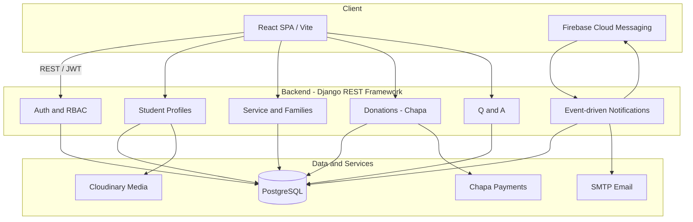

<div align="center">

# Finot

**Spiritual lifecycle management platform for university students**

A full-stack monorepo for the Gibi Gubae fellowship — student identity, ministry participation, mentorship families, events, donations, and anonymous spiritual counseling in one unified system.

[Backend docs](./backend/README.md) · [Frontend docs](./frontend/README.md) · [API (Swagger)](https://finot.onrender.com/api/docs/swagger/)

</div>

---

## Table of contents

- [Overview](#overview)
- [Architecture](#architecture)
- [Repository structure](#repository-structure)
- [Features](#features)
- [Tech stack](#tech-stack)
- [Prerequisites](#prerequisites)
- [Getting started](#getting-started)
- [Environment variables](#environment-variables)
- [Development workflow](#development-workflow)
- [Testing](#testing)
- [Deployment](#deployment)
- [Documentation](#documentation)
- [Contributing](#contributing)
- [License](#license)

---

## Overview

**Finot** is a production-oriented web platform that supports the **spiritual life and community participation of university students** in the Gibi Gubae fellowship. It is not generic admin software — the product is built around a student's **spiritual lifecycle**: identity, community, and contribution.

This repository is a **monorepo** containing:

| Package | Path | Role |
|---------|------|------|
| **Backend API** | [`backend/`](./backend/) | Django REST API — auth, profiles, ministries, events, donations, Q&A, notifications |
| **Frontend app** | [`frontend/`](./frontend/) | React SPA — student dashboard, admin tools, i18n, Firebase push |

The backend and frontend were developed in separate repositories and merged here with **full git history preserved** under their respective folders.

---

## Architecture



**Design principles**

- **Identity first** — students complete a profile before accessing core features.
- **Community structure** — ministries (service groups), mentorship families, and fellowship events.
- **Decoupled notifications** — domain signals → dispatcher → channel registry (in-app, email, push); failures in one channel do not block others.
- **UX-driven frontend** — the React app mirrors user journeys, not Django app layout.

---

## Repository structure

```
finot-system/
├── backend/                 # Django + DRF API
│   ├── config/              # Settings, URLs, WSGI/ASGI
│   ├── core/                # Auth, roles, shared models
│   ├── student/             # Student profiles
│   ├── service/             # Ministries, families, events, attendance
│   ├── donation/            # Chapa payment integration
│   ├── questionanswer/      # Public and private Q&A
│   ├── notifications/       # Multi-channel notification engine
│   ├── course/              # Course coordination and materials
│   ├── resources/           # Shared learning resources
│   ├── manage.py
│   ├── pyproject.toml       # Python dependencies (uv/pip)
│   └── README.md
│
├── frontend/                # React + Vite SPA
│   ├── src/
│   │   ├── pages/           # Route-level screens
│   │   ├── components/      # Shared UI
│   │   ├── layouts/         # Main and dashboard shells
│   │   ├── context/         # Auth and global state
│   │   ├── lib/             # API client, i18n, Firebase
│   │   └── assets/locales/  # en, am, om translations
│   ├── public/
│   ├── vite.config.ts
│   ├── package.json
│   └── README.md
│
└── README.md                # This file
```

---

## Features

### Platform

- **Role-based access control (RBAC)** — admins, coordinators, counselors, moderators, and students with scoped permissions.
- **Student profiles** — academic and fellowship identity gating access to the rest of the platform.
- **Ministry (Ageglot) participation** — service groups, ranked selection, and family mentorship structure.
- **Events and attendance** — fellowship and course events with bulk and per-session tracking.
- **Donations** — Chapa payment integration with webhook-driven, concurrency-safe processing.
- **Q&A** — public questions (moderated) and private counselor channels (anonymous where configured).
- **Notifications** — in-app, email (SMTP), and push (Firebase); event-driven, non-blocking delivery.
- **Internationalization** — English, Amharic, and Oromo UI support on the frontend.

### Developer experience

- **OpenAPI 3** — auto-generated Swagger UI and ReDoc on the backend.
- **Modular Django apps** — clear domain boundaries with signals and dedicated test suites.
- **Vite dev proxy** — frontend proxies `/api` and `/auth` to the backend during local development.

---

## Tech stack

| Layer | Technologies |
|-------|----------------|
| **Backend** | Python 3.13+, Django 5.1, Django REST Framework, drf-spectacular, PostgreSQL, Gunicorn |
| **Auth** | JWT (djoser / dj-rest-auth), django-allauth, Google OAuth |
| **Payments** | Chapa API + webhooks |
| **Media** | Cloudinary |
| **Push** | Firebase Admin SDK (FCM) |
| **Admin UI** | django-unfold |
| **Frontend** | React 19, TypeScript, Vite 7, Tailwind CSS, Axios, react-router-dom |
| **i18n** | i18next, react-i18next |
| **Tooling** | uv/pyproject (backend), pytest, npm (frontend) |

---

## Prerequisites

| Tool | Version | Used by |
|------|---------|---------|
| Python | 3.13+ | Backend |
| PostgreSQL | 14+ recommended | Backend |
| Node.js | 18+ (20 LTS recommended) | Frontend |
| npm | 9+ | Frontend |
| uv or pip | latest | Backend dependency install |

Optional: Firebase project, Chapa merchant account, Cloudinary account, SMTP credentials (required for production features).

---

## Getting started

Clone the monorepo and set up **backend** and **frontend** independently.

### 1. Clone

```bash
git clone git@github.com:mogesTesema/finot-fullstack-system.git
cd finot-fullstack-system
```

### 2. Backend

```bash
cd backend

# Create and activate a virtual environment
python -m venv .venv
source .venv/bin/activate

# Install dependencies (uv recommended)
uv sync
# or: pip install -e ".[dev]"

# Configure environment (see Environment variables)
# Create backend/finot.env with required secrets

# Migrate and run
python manage.py migrate
python manage.py runserver
```

API runs at **http://127.0.0.1:8000**

- Swagger UI: http://127.0.0.1:8000/api/docs/swagger/
- ReDoc: http://127.0.0.1:8000/api/docs/redoc/

### 3. Frontend

```bash
cd frontend

npm install

# Configure environment (see Environment variables)
# Create .env with VITE_API_URL pointing at your backend

npm run dev
```

Dev server defaults to **http://127.0.0.1:5176** (see [`frontend/vite.config.ts`](./frontend/vite.config.ts)).

Point `VITE_API_URL` at your local backend (e.g. `http://127.0.0.1:8000`) or use the Vite proxy targets already configured for `/api` and `/auth`.

### 4. Run both (two terminals)

```bash
# Terminal 1
cd backend && source .venv/bin/activate && python manage.py runserver

# Terminal 2
cd frontend && npm run dev
```

---

## Environment variables

### Backend (`backend/finot.env`)

| Variable | Purpose |
|----------|---------|
| `SECRET_KEY` | Django secret key |
| `DATABASE_URL` or DB vars | PostgreSQL connection |
| `CHAPA_SECRET_KEY` | Chapa API secret |
| `CHAPA_WEBHOOK_SECRET` | Webhook signature verification |
| `FIREBASE_CREDENTIALS_B64` | Base64-encoded Firebase Admin JSON |
| Cloudinary keys | Media upload and storage |
| SMTP settings | Transactional email |

See [`backend/README.md`](./backend/README.md) for the full list and setup notes.

### Frontend (`.env` in `frontend/`)

| Variable | Purpose |
|----------|---------|
| `VITE_API_URL` | Backend base URL for Axios (e.g. `http://127.0.0.1:8000`) |

Firebase client configuration is defined in [`frontend/src/lib/firebase.ts`](./frontend/src/lib/firebase.ts) and related files.

> **Security:** Never commit `finot.env`, `.env`, or credential files. Keep secrets out of version control.

---

## Development workflow

1. **Branch from `main`** — use feature branches; open PRs against `main`.
2. **Backend changes** — run migrations when models change; update OpenAPI-sensitive serializers/views as needed.
3. **Frontend changes** — keep route gating (`ProtectedRoute`, profile-complete checks) aligned with backend rules.
4. **Cross-cutting changes** — update both packages when API contracts or auth flows change; consult nested docs before renaming endpoints.
5. **Commits** — prefer scoped messages (`backend: …`, `frontend: …`) in this monorepo.

---

## Testing

### Backend

```bash
cd backend
source .venv/bin/activate
pytest
```

Uses `config.settings_test`, pytest-django, and coverage reporting (see [`backend/pytest.ini`](./backend/pytest.ini)).

### Frontend

The frontend includes component and integration tests in select modules. Run via your configured test runner when present; see [`frontend/README.md`](./frontend/README.md) for UX and architecture context used when authoring tests.

---

## Deployment

| Component | Typical target | Notes |
|-----------|----------------|-------|
| **Backend** | Render / similar PaaS | Gunicorn + PostgreSQL; set `finot.env` vars on the host |
| **Frontend** | Vercel / static CDN | `npm run build`; SPA rewrites in [`frontend/vercel.json`](./frontend/vercel.json) |

Production API reference used in frontend dev config: `https://finot.onrender.com`

After deployment, set `VITE_API_URL` to the production API origin and configure CORS on the backend for the frontend domain.

---

## Documentation

| Document | Location |
|----------|----------|
| Backend overview and notification architecture | [`backend/README.md`](./backend/README.md) |
| Frontend UX / product brief | [`frontend/README.md`](./frontend/README.md) |
| Frontend architecture | [`frontend/docs/FRONTEND_ARCHITECTURE.md`](./frontend/docs/FRONTEND_ARCHITECTURE.md) |
| API module references | [`frontend/backend-api_documentation/`](./frontend/backend-api_documentation/) |
| System architecture and user flows | [`frontend/backend-api_documentation/SYSTEM_ARCHITECTURE_AND_FLOW.md`](./frontend/backend-api_documentation/SYSTEM_ARCHITECTURE_AND_FLOW.md) |
| Backend system documentation | [`backend/system_documentation.md`](./backend/system_documentation.md) |

---

## Contributing

1. Fork or branch from `main`.
2. Make focused changes in `backend/` or `frontend/`.
3. Run relevant tests before opening a PR.
4. Update documentation when behavior, env vars, or API contracts change.

For product and UX decisions, align with the principles in [`frontend/README.md`](./frontend/README.md): welcoming, supportive, community-focused — not data-entry software.

---

## License

Proprietary — Gibi Gubae / Finot project. Contact maintainers for usage terms.

---

<div align="center">

Built for **HIRUY Hackathon 2026**

**Finot** — *Identity · Community · Contribution*

</div>
