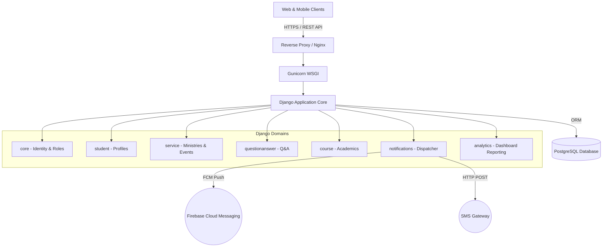
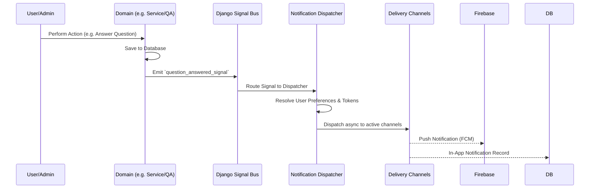
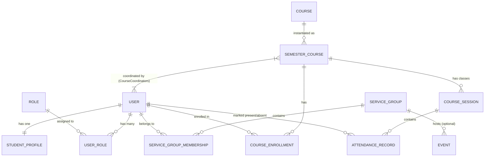

# Finot Backend — System Architecture & Documentation

## 1. Executive Summary

Finot Backend is an enterprise-grade community, service, and academic management system built for the Ethiopian Orthodox Church university student communities. Designed to handle thousands of concurrent users, the system acts as the centralized API layer for mobile and web frontends, managing everything from student demographics and service ministry assignments to religious Q&A, event broadcasting, and academic tracking.

---

## 2. High-Level System Architecture

The system utilizes a monolithic deployment strategy for operational simplicity while strictly enforcing modular domain separation internally. 

### 2.1 Technology Stack
- **Framework**: Django 4.x / Django REST Framework (DRF)
- **Database**: PostgreSQL
- **Authentication**: JWT (JSON Web Tokens) via `djangorestframework-simplejwt`
- **External Services**: Firebase Cloud Messaging (FCM) for push notifications, Custom SMS Gateway.

---

## 3. Event-Driven Notification Architecture

To prevent tight coupling between core business logic and third-party delivery systems, Finot utilizes an internal event-driven architecture via **Django Signals**. This ensures that if external services fail, core functionality (like answering a question) is not blocked.

---

## 4. Analytics & Reporting Architecture

Finot employs a decoupled, registry-based pattern to handle system-wide analytics. Instead of the core admin dashboard explicitly importing from feature applications (which causes circular dependencies and tight coupling), the `analytics` app acts as a central aggregator.

- **Dashboard Registry Pattern**: Feature applications (like `donation`, `course`, `questionanswer`) register their metrics and visualization data into a central `DashboardStatsRegistry`.
- **Time-Series Aggregation**: The dashboard performs isolated, dynamic database aggregations (using `TruncDate`, `TruncWeek`, `TruncMonth`). This allows administrators to analyze independent temporal ranges (e.g., 30-day attendance vs. 1-year donations) simultaneously on the same dashboard.
- **Admin UI Integration**: The analytics engine is deeply integrated into the custom Django Unfold admin theme, utilizing Chart.js for seamless data visualization.

---

## 5. System Requirements

### 5.1 Functional Requirements
- **Identity & Role Management (RBAC)**: Multi-tiered access allowing users to hold multiple roles simultaneously (Student, SuperAdmin, ServiceAdmin, QACounselor, CourseCoordinator).
- **Service & Ministry Management**: Organization of users into specific service groups (Agelglot) with hierarchical admin structures.
- **Event Broadcasting**: Context-aware broadcasting where general events alert all users, but service-specific events are strictly scoped to active members of that group to prevent notification fatigue.
- **Counselor Q&A**: A dual-layered system supporting public moderated forums and private, confidential 1-on-1 counselor threads that bypass standard moderation loops.
- **Academic Course Tracking**: Management of static yearly curriculums mapped to dynamic semester courses. Course Coordinators (nominated students) manage session scheduling, bulk student enrollment, granular session-based attendance tracking, and material uploads. Guest teacher names are recorded per-session to support rotating lecturers.

### 5.2 Non-Functional Requirements
- **Scalability via Bulk Operations**: The system must support massive bulk operations (e.g., batch-enrolling 1,000 students into a semester course, or marking 500 attendance records) in a single database transaction using Django's `bulk_create` and custom admin actions.
- **Anti-N+1 Query Guarantees**: Strict enforcement of query optimization using `select_related` and `prefetch_related` across all API views to prevent database bottlenecks.
- **Security**: 
  - JWT authentication for all endpoints.
  - Role-based API permission classes (e.g., `IsQACounselor`, `IsCourseCoordinator`, `IsAdminOrOwner` which dynamically grants elevated object permissions to system moderators).
  - Moderation Security: Strict viewset validation ensures that modifying an approved public Q&A object automatically revokes its approval status, forcing it back to the moderation queue to prevent bypass exploits. Detail querysets are dynamically context-aware to ensure users can only access their own unapproved content while keeping it hidden from the public.
  - Strict Rate Limiting (e.g., 30 requests/minute) to prevent DDoS and brute-force attacks.
  - UUID primary keys on all sensitive models to prevent ID enumeration.

---

## 6. Database Entity-Relationship (ER) Design

The database strictly adheres to normalized relational design patterns, ensuring data integrity over time.

### 6.1 Temporal Decoupling Pattern
For academic courses, static blueprints (`Course`) are cleanly separated from temporal instances (`SemesterCourse`). This guarantees that historical data (e.g., "Who taught Church History in 2024?") is permanently preserved without duplicating the curriculum definitions.

### 6.2 Core Entity Relationship Diagram

### 6.3 Security & Data Integrity Constraints
- **Unique Constraints**: Absolute reliance on database-level `UniqueConstraints` (e.g., `(semester_course_id, student_id)` prevents double enrollment; `(session_id, student_id)` prevents double attendance).
- **Scoped Lookups**: Visibility and permission filtering (like event broadcasts and private Q&A threads) are executed purely at the database layer via `INNER JOIN`s (e.g., `.filter(service_group__members=user)`), avoiding massive memory consumption and race conditions in Python.
- **Cascading Deletes**: Controlled cascading ensures that if a `SemesterCourse` is deleted, its orphaned `CourseSession` and `AttendanceRecord` entries are automatically purged without leaving dangling references.

---
*Note: This document is the Single Source of Truth for the Finot Backend architecture. It must be updated iteratively as new domains or infrastructural paradigms are introduced.*
